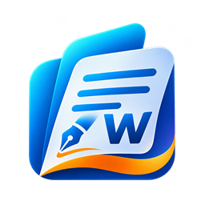

<p align="center"></p>

# OpenWrite

Traitement de texte pour Windows (C# / .NET 10 / WPF), de la famille d'[OpenPub](https://github.com/prolice/open-pub), conçu pour remplacer Microsoft Word hors ligne : il **ouvre et enregistre directement les documents `.docx`**, sans rien perdre de ce qu'il ne sait pas encore modifier.

**État : version 0.1 en développement** (lot 0 du plan) — ruban aux onglets de Word, ouverture d'un `.docx` en lecture seule (aperçu du texte, informations, plan des titres), infrastructure reprise d'OpenPub. Feuille de route complète dans [`PLAN.md`](PLAN.md).

## Structure

| Dossier | Contenu |
|---|---|
| `src/OpenWrite.Core` | Logique pure : (à venir) modèle de document en flux et annulation ; mises à jour signées, rapports d'erreur, copies de secours, enregistrement sûr |
| `src/OpenWrite.Docx` | Lecture et écriture des `.docx` (Open XML SDK) |
| `src/OpenWrite.Layout` | Moteur de mise en page : césure (à venir : lignes, pagination) |
| `src/OpenWrite.App` | Application WPF : ruban, volets, fenêtres, aide, mises à jour |
| `tests/OpenWrite.Tests` | Tests xUnit (documents fabriqués dans les tests) |
| `tools/` | Outils (PDF de référence produits par Word) |
| `assets/OpenWrite-package-complet` | Charte graphique (logo, maquette du portail) |

## Développement

```powershell
dotnet build OpenWrite.sln
dotnet test tests/OpenWrite.Tests
dotnet run --project src/OpenWrite.App -- chemin\vers\document.docx
```

## Composants tiers

- Lecture des `.docx` : [Open XML SDK](https://github.com/dotnet/Open-XML-SDK) (licence MIT), paquet NuGet `DocumentFormat.OpenXml`.
- Polices de l'interface **DM Sans** et **Plus Jakarta Sans** : SIL Open Font License 1.1 (`src/OpenWrite.App/Fonts/OFL-*.txt`).
- Motifs de césure français (`src/OpenWrite.Layout/Resources/hyph_fr.dic`) : dictionnaire de césure de LibreOffice (LGPL / MPL), distribué via pyphen.
